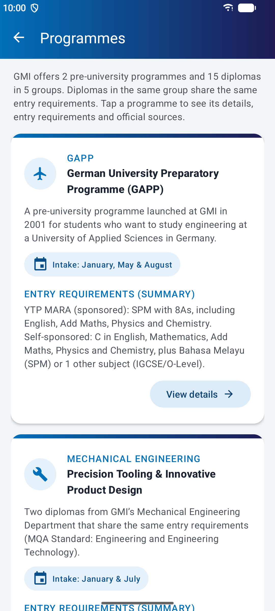
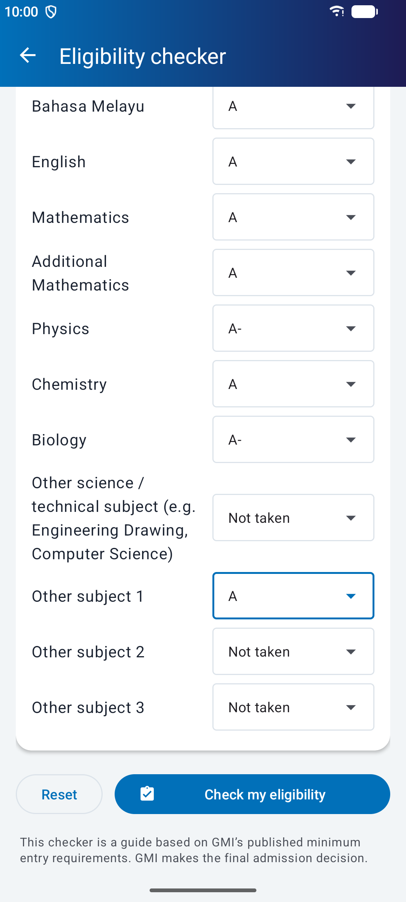
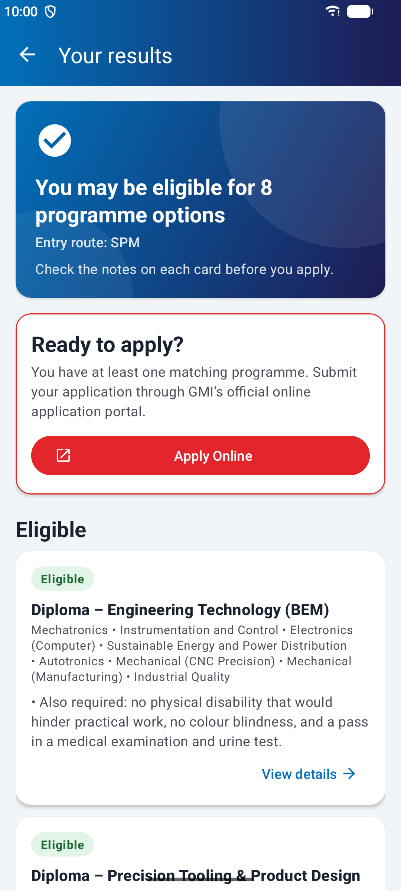
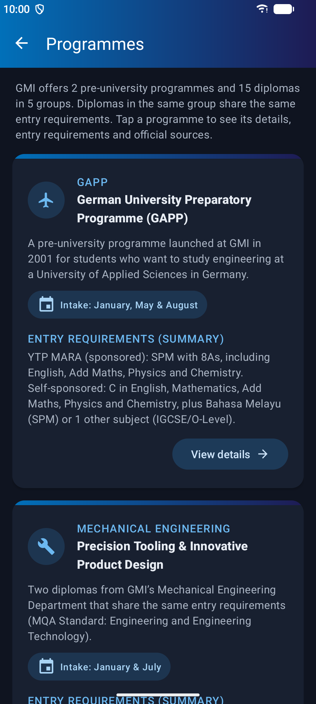

# GMI Prospect Application

A native Android app (Java + XML) for prospective students of the **German-Malaysian Institute (GMI)**.
It introduces GMI, lists its programmes with their entry requirements, checks a student's results
against GMI's published minimum requirements, links to the official online application, and shows
GMI's official contact details.

Built for the SPG0562 Android Programming mini project.

> This is a student project. It is not an official GMI app. Check entry requirements with GMI
> before you apply.

## Download

**[⬇ Download the APK (v1.0)](https://github.com/Haruu49/gmi-prospect-app/releases/latest/download/GMI-Prospect-v1.0.apk)**,
or see all versions on the [Releases page](https://github.com/Haruu49/gmi-prospect-app/releases).

Needs **Android 12 (API 31) or newer**. To install it, open the APK on your phone and allow
*Install unknown apps* for your browser or file manager when Android asks.

## Screenshots

| Home | Programmes | Programme details |
|:---:|:---:|:---:|
|  |  |  |
| **Eligibility checker** | **Results** | **Dark mode** |
|  |  |  |

More screenshots are in [`docs/screenshots/`](docs/screenshots/).

## Features

- **Programme guide:** 7 programme cards covering GAPP, 15 diplomas in 5 groups and GUFP, each with
  an overview, key facts, entry requirements and links to the official sources.
- **Eligibility checker:** enter SPM, O-Level/IGCSE or UEC grades and the app shows each programme as
  *Eligible*, *Requirements not met* or *Route not listed*, and lists the requirements that are not met.
- **Apply Online:** appears when at least one programme is eligible and opens GMI's official online
  application page.
- **About & Contact:** address, phone, email and WhatsApp open in Maps, the dialler or the email app,
  with links to the enquiry form and GMI's social media pages.
- Material 3 design, dark mode, splash screen and edge-to-edge layout. Grades you enter are kept when
  the phone is rotated.

Programme content and entry requirements come from gmi.edu.my and the **GMI Programme Guide, May
2026 (rev 02)**, checked on 5 November 2026.

## Tech stack

- Java 11, XML layouts, Android SDK 37 (min SDK 31)
- Material Components 3, RecyclerView, AndroidX SplashScreen
- JUnit 4: **28 unit tests** for the eligibility rules and programme mapping
- Gradle (Kotlin DSL), Android Gradle Plugin 9.5

## Build and run

1. Open **Android Studio** and choose **File ▸ Open**, then select this folder (the one containing
   `settings.gradle.kts`).
2. Wait for **Gradle sync** to finish.
3. Pick an emulator or phone with **Android 12 (API 31) or newer**.
4. Choose the **app** run configuration and click **Run ▶** (Shift+F10).

From a terminal:

```bash
./gradlew test            # run the unit tests
./gradlew assembleDebug   # build app/build/outputs/apk/debug/app-debug.apk
```

## Project structure

```
app/src/main/
├── AndroidManifest.xml                 6 activities; MainActivity launches with the splash theme
├── java/com/example/gmiapps/
│   ├── BaseActivity.java               Shared: edge-to-edge, toolbar + back, contact/info rows
│   ├── MainActivity.java               Home: splash, welcome banner, highlights, programme cards
│   ├── ProgrammesActivity.java         Programme list (RecyclerView)
│   ├── ProgrammeDetailActivity.java    Overview, key facts, requirements, sources
│   ├── EligibilityActivity.java        Entry route + grade input form
│   ├── EligibilityResultActivity.java  Runs the checker, shows results, "Apply Online" button
│   ├── AboutContactActivity.java       About GMI, contact details, enquiries, map, social links
│   ├── adapter/ProgrammeAdapter.java   RecyclerView adapter for programme cards
│   ├── data/Programme.java             Programme model (string resource ids + Builder)
│   ├── data/ProgrammeRepository.java   The 7 programme cards (GAPP, 5 diploma groups, GUFP)
│   ├── eligibility/                    Eligibility logic (no Android UI, unit tested)
│   │   ├── EligibilityChecker.java     The rules for every programme, with source comments
│   │   ├── GradeScale.java             SPM / O-Level / UEC grade order, credit and pass grades
│   │   ├── EntryRoute.java             SPM, O-Level/IGCSE, UEC, Other
│   │   ├── Subject.java                Subjects shown in the form
│   │   ├── ProgrammeTrack.java         8 requirement groups (5 diploma groups, 2 GAPP routes, GUFP)
│   │   └── TrackResult.java, EligibilityStatus.java, UnmetRequirement.java, Condition.java
│   └── util/                           IntentUtils (URL, dial, email, maps), AnimUtils
└── res/
    ├── layout/                         One layout per screen, plus cards, rows and the app bar
    ├── values/strings.xml              All user-facing text, including programme content
    ├── values/links.xml                Official URLs, phone and email used by intents
    ├── values/colors.xml, values-night/colors.xml   GMI palette + dark mode
    └── values/themes.xml               Material 3 theme + splash screen theme
app/src/test/                           EligibilityCheckerTest, ProgrammeRepositoryTest
docs/eligibility-flowchart.png          Flowchart of the eligibility check
docs/screenshots/                       Screenshots taken on the emulator
```

**Updating content:** text lives in `res/values/strings.xml` and links in `res/values/links.xml`. If
GMI changes an entry requirement, update the matching `case` in `EligibilityChecker.evaluate()` and
the `prog_*_requirements` string, then run the unit tests again.

The GMI name and logo belong to the German-Malaysian Institute.
